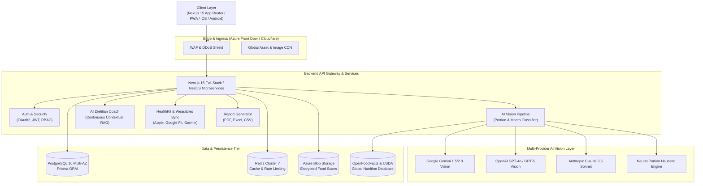
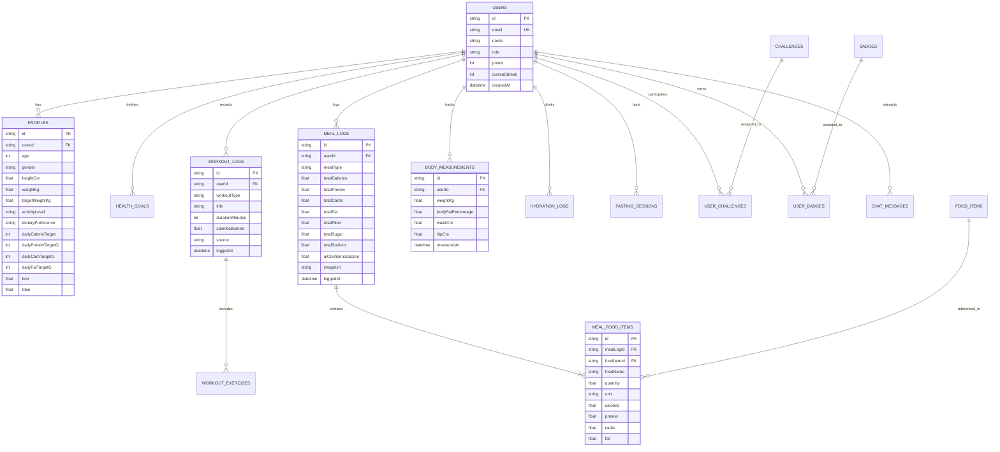

# FitLens AI — Enterprise System Architecture & Engineering Documentation

## 1. System Architecture Overview

FitLens AI is engineered as a cloud-native, microservice-ready, edge-accelerated health intelligence platform. It fuses high-precision computer vision (OpenAI GPT-4o / Google Gemini 1.5/2.0 Flash / Claude 3.5 Sonnet) with continuous biometric telemetry, automated meal classification, and real-time dietitian coaching.

### Architecture Diagram



---

## 2. Entity-Relationship (ER) Diagram



---

## 3. REST API Specifications

| Method | Endpoint | Description | Auth Required |
|---|---|---|---|
| `POST` | `/api/food/scan` | Analyzes image via multi-model Vision (food name, portion, macros, confidence score) | Yes |
| `GET` | `/api/food/search?q={query}&category={cat}` | Searches verified Indian, Global, and Packaged food items | Yes |
| `GET` | `/api/food/barcode?barcode={code}` | Lookups packaged barcode via verified database & OpenFoodFacts | Yes |
| `POST` | `/api/coach/chat` | AI Dietitian chat endpoint with real-time biometric context | Yes |
| `POST` | `/api/workouts` | Logs workout activities (Gym, Running, Walking) with sets/reps | Yes |
| `GET` | `/api/reports/export` | Generates daily/monthly reports in PDF, Excel, and CSV format | Yes |
| `POST` | `/api/fasting/toggle` | Starts/ends an intermittent fasting session (16:8, 18:6, OMAD) | Yes |

---

## 4. UI Wireframes & Design System

### Design Language: Apple Health & Fitness Dark Mode
- **Background**: `#070A11` (Deep Midnight Carbon)
- **Glassmorphic Cards**: `rgba(26, 36, 56, 0.6)` with `backdrop-filter: blur(16px)`
- **Fitness Accents**:
  - **Calorie Activity Red/Orange**: `#FF2D55` to `#FF9500`
  - **Protein Neon Green**: `#00E073` / `#30D158`
  - **Hydration Aqua Cyan**: `#00C7BE` / `#32ADE6`
  - **Fasting Amber**: `#FF9500`

### Desktop & Mobile Layout Architecture
```
+-----------------------------------------------------------------------------------+
|  [FitLens AI Pro]     🔥 6-Day Streak    🏆 420 pts    ⏱️ 14h 30m Fast    [Scan Food] |
+-----------------------+-----------------------------------------------------------+
| [Navigation Sidebar]  |  [3-Ring Nutrition Visualizer]   [Caloric & Macro Ledger] |
| • Dashboard           |  • Calories: 1,890 / 1,950 kcal  • Protein: 118g / 115g   |
| • Workouts & Sync     |  • Protein:  118g / 115g         • Carbs:   210g          |
| • Body Progress       |  • Water:    2.1L / 2.8L         • Fats:    55g           |
| • Health Reports      +-----------------------------------------------------------+
| • Meal Planner        |  [Intermittent Fasting Timer]    [Smart Hydration Widget] |
| • Challenges          |  14h 30m elapsed (Fat Oxidation) Quick Log: +250ml/+500ml |
| • Admin Console       +-----------------------------------------------------------+
|                       |  [AI Nutrition Coach Real-time Alerts & Food Prescriptions]|
| [AI Scanner Tools]    +-----------------------------------------------------------+
| 📷 Vision Food Camera |  [Today's Classified Meals: Breakfast, Lunch, Snack, Dinner] |
| 🏷️ Barcode Lookup     +-----------------------------------------------------------+
| 🎙️ Voice Logger      |  [Workout Progression & Apple Health / Google Fit Sync]   |
+-----------------------+-----------------------------------------------------------+
```

---

## 5. Folder Structure

```
FitLens_AI/
├── prisma/
│   └── schema.prisma            # Comprehensive PostgreSQL Prisma schema
├── src/
│   ├── app/
│   │   ├── api/
│   │   │   ├── coach/chat/route.ts
│   │   │   ├── food/barcode/route.ts
│   │   │   ├── food/scan/route.ts
│   │   │   └── food/search/route.ts
│   │   ├── globals.css          # Fitness dark mode, glowing rings, print CSS
│   │   ├── layout.tsx           # Root viewport & font layout
│   │   └── page.tsx             # Main dashboard reactive hub
│   ├── components/
│   │   ├── admin/
│   │   │   └── AdminDashboard.tsx
│   │   ├── body/
│   │   │   └── BodyProgressTracker.tsx
│   │   ├── challenges/
│   │   │   └── ChallengesGamification.tsx
│   │   ├── coach/
│   │   │   └── AICoachChat.tsx
│   │   ├── dashboard/
│   │   │   ├── AICoachAlerts.tsx
│   │   │   ├── DailyStatsCards.tsx
│   │   │   ├── FastingWidget.tsx
│   │   │   ├── HydrationCard.tsx
│   │   │   ├── NutritionRings.tsx
│   │   │   └── RecentMealsList.tsx
│   │   ├── layout/
│   │   │   ├── MobileNav.tsx
│   │   │   ├── Navbar.tsx
│   │   │   └── Sidebar.tsx
│   │   ├── reports/
│   │   │   └── ReportsView.tsx
│   │   ├── scanner/
│   │   │   ├── BarcodeScannerModal.tsx
│   │   │   ├── FoodScannerModal.tsx
│   │   │   ├── MenuScannerModal.tsx
│   │   │   └── VoiceMealModal.tsx
│   │   ├── tools/
│   │   │   └── AIMealPlannerView.tsx
│   │   └── profile/
│   │       └── UserProfileModal.tsx
│   ├── lib/
│   │   ├── ai/
│   │   │   ├── dietitian-coach.ts
│   │   │   └── vision-service.ts
│   │   ├── db/
│   │   │   ├── food-database.ts
│   │   │   └── mock-data.ts
│   │   └── utils/
│   │       ├── export-helpers.ts
│   │       └── nutrition-calc.ts
│   └── types/
│       └── index.ts
├── backend-nestjs/               # Enterprise NestJS microservices scaffold
│   └── src/
├── k8s/                          # Production Kubernetes manifests
│   ├── configmap.yaml
│   ├── deployment.yaml
│   └── ingress-hpa-service.yaml
├── .github/workflows/
│   └── ci-cd.yml                 # Automated CI/CD pipeline
├── Dockerfile                    # Multi-stage optimized Docker build
├── docker-compose.yml            # Complete stack: Next.js + Postgres + Redis
└── ARCHITECTURE.md               # Master technical documentation
```

---

## 6. Testing Strategy

1. **Unit Tests (Jest & Vitest)**:
   - Mifflin-St Jeor formula & BMR/TDEE calculation validation
   - Calorie deficit/surplus projections & 30-day weight estimation
   - Nutrition score (0-100) weighting algorithm
   - Fasting phase state machine transitions
2. **Integration Tests (Supertest & Next.js API Route Tests)**:
   - `/api/food/scan` with mock image payloads verifying confidence score thresholds
   - OpenFoodFacts external fallback error recovery
   - Chat context injection verifying user goal awareness
3. **End-to-End (E2E) Tests (Playwright / Cypress)**:
   - User snaps food photo -> AI detects "Paneer Tikka" -> confirms portion -> rings animate -> daily ledger increments
   - Report PDF/Excel export triggers file download
   - Offline PWA service worker caching

---

## 7. Scalability Plan (100k+ Concurrent Users)

1. **Horizontal Pod Autoscaling (HPA)**: Kubernetes HPA scales pods from 3 to 15 based on 70% CPU and 80% Memory thresholds.
2. **Multi-Provider AI Vision Load Balancing**: Incoming food scanning traffic dynamically load-balances across Gemini Vision, OpenAI GPT-4o, and Claude Vision with circuit breakers.
3. **Distributed Redis Caching**:
   - Cache frequent food database queries (TTL: 24h)
   - Cache user daily aggregated macro stats (invalidated only on meal log writes)
   - Rate limiting: 60 scans / minute / tier
4. **PostgreSQL Read Replicas & Connection Pooling**: PgBouncer connection pooler manages connections up to 5,000 active sessions with read queries routed to Azure PostgreSQL Read Replicas.
5. **Edge Asset Offloading**: All food photo uploads are processed, downscaled client-side, and streamed directly to Azure Blob Storage with CDN edge caching.
